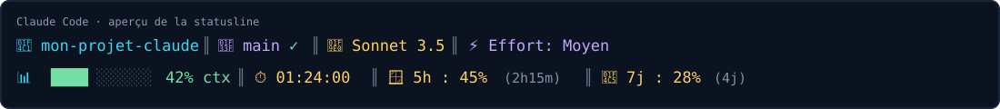

# ClaudeStatusLine

Statusline compacte sur **deux lignes** pour [Claude Code](https://docs.anthropic.com/en/docs/claude-code), avec emojis, séparateurs `║`, barre de contexte et fenêtres de quota.

## Aperçu



Les valeurs ci-dessus sont illustratives. Les informations de quotas et leur réinitialisation s'affichent uniquement si elles sont fournies dans les données reçues de Claude Code.

### État Git propre

```text
📁 mon-projet-claude║🌿 main ✓║🧠 Sonnet 3.5║⚡ Effort: Moyen
📊 ████░░░░░░ 42% ctx║⏱️ 01:24:00║🪟 5h : 45% (2h15m)║📅 7j : 28% (4j)
```

### État Git avec modifications

```text
📁 mon-projet-claude║🌿 main ✏️║🧠 Sonnet 3.5║⚡ Effort: Moyen
📊 ████░░░░░░ 42% ctx║⏱️ 01:24:00║🪟 5h : 45% (2h15m)║📅 7j : 28% (4j)
```

## Éléments affichés

- **Ligne 1 :** dossier du projet, branche Git et indicateur propre/modifié, modèle, niveau d'effort.
- **Ligne 2 :** barre de contexte sur 10 segments, pourcentage de contexte, durée au format `HH:MM:SS`, consommation de la fenêtre de 5 heures et de 7 jours avec compte à rebours si disponible.
- Les indicateurs de Git sont `✓` lorsque le dépôt est propre et `✏️` lorsqu'il contient des modifications.
- Les pourcentages et temps de l'aperçu sont des exemples, pas des valeurs codées en dur.

## Prérequis

- Claude Code installé.
- Bash, Python 3 et Git.
- Terminal prenant en charge les couleurs ANSI et les emojis.

## Installation globale

1. Clone le dépôt et copie le script dans le dossier de configuration utilisateur :

   ```bash
   git clone https://github.com/CedPer/claudestatusline.git
   cd claudestatusline
   mkdir -p ~/.claude
   cp statusline.sh ~/.claude/statusline.sh
   chmod +x ~/.claude/statusline.sh
   ```

2. Ouvre `~/.claude/settings.json` et ajoute `statusLine` à l'objet JSON existant :

   ```json
   "statusLine": {
     "type": "command",
     "command": "~/.claude/statusline.sh",
     "padding": 0
   }
   ```

   Si le fichier n'existe pas, crée-le avec un objet JSON complet. **Ne remplace pas les autres paramètres existants** et veille à conserver une syntaxe JSON valide.

3. Redémarre Claude Code ou démarre une nouvelle session.

## Vérification et dépannage

- Vérifie les permissions : `ls -l ~/.claude/statusline.sh`
- Vérifie les dépendances : `command -v bash python3 git`
- Si le modèle, l'effort, le contexte ou la durée n'apparaît pas correctement, les champs correspondants peuvent différer selon la version de Claude Code.
- Les fenêtres de quota de 5 heures et de 7 jours sont facultatives : elles ne s'affichent que si les données sont présentes.
- Si les emojis sont mal rendus, utilise un terminal et une police compatibles Unicode.

## Consommation

Le script s'exécute localement. Il ne fait aucun appel API et ne consomme pas de tokens de modèle ; il utilise un peu de CPU pour lire le JSON et vérifier l'état Git.
